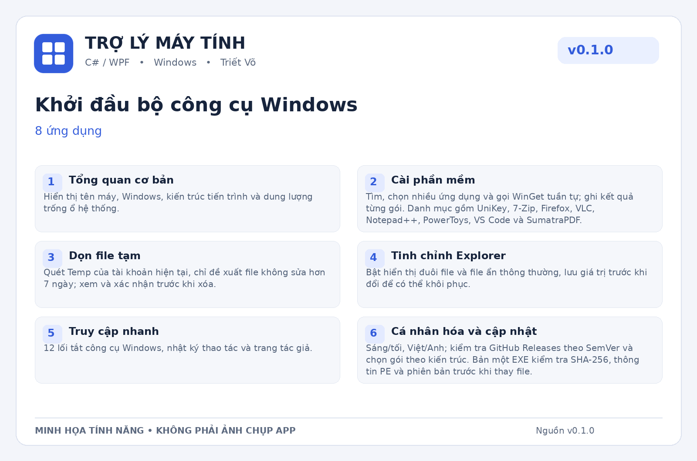

<p align="center">
  
</p>

# Trợ Lý Máy Tính · v0.1.0

**Khởi đầu bộ công cụ Windows.**

Ứng dụng desktop **C# / WPF** giúp tập trung công cụ hỗ trợ Windows vào một nơi. Tác giả: **Triết Võ**. Giao diện **Tiếng Việt / English**, **Sáng / Tối**. Bản này có **8 ứng dụng**.

> Đây là tài liệu cho **mã nguồn v0.1.0**, không phải thông báo đã phát hành EXE ổn định. Chưa có kết quả build C#, chạy WPF hoặc kiểm thử Windows được xác nhận trong môi trường biên soạn. Các chức năng bên dưới mô tả phần đã viết mã và giới hạn tương ứng.



*Ảnh minh họa nội dung phiên bản; không phải ảnh chụp ứng dụng đang chạy. Logo được dùng thống nhất cho bộ tài liệu lịch sử.*

## Điểm đáng chú ý của phiên bản

| Hạng mục | Nội dung |
| --- | --- |
| **Tổng quan cơ bản** | Hiển thị tên máy, Windows, kiến trúc tiến trình và dung lượng trống ổ hệ thống. |
| **Cài phần mềm** | Tìm, chọn nhiều ứng dụng và gọi WinGet tuần tự; ghi kết quả từng gói. Danh mục gồm UniKey, 7-Zip, Firefox, VLC, Notepad++, PowerToys, VS Code và SumatraPDF. |
| **Dọn file tạm** | Quét Temp của tài khoản hiện tại, chỉ đề xuất file không sửa hơn 7 ngày; xem và xác nhận trước khi xóa. |
| **Tinh chỉnh Explorer** | Bật hiển thị đuôi file và file ẩn thông thường, lưu giá trị trước khi đổi để có thể khôi phục. |
| **Truy cập nhanh** | 12 lối tắt công cụ Windows, nhật ký thao tác và trang tác giả. |
| **Cá nhân hóa và cập nhật** | Sáng/tối, Việt/Anh; kiểm tra GitHub Releases theo SemVer và chọn gói theo kiến trúc. Bản một EXE kiểm tra SHA-256, thông tin PE và phiên bản trước khi thay file. |

## Bắt đầu sử dụng

1. Xem Tổng quan và chọn ngôn ngữ, giao diện trong Cài đặt.
2. Mở Cài phần mềm, tìm gói, chọn mục và đọc kết quả cài từng ứng dụng.
3. Với Dọn dẹp hoặc Tinh chỉnh, xem danh sách thay đổi trước khi xác nhận.

Các thao tác cài gói, bảo trì hoặc thay đổi Windows có thể yêu cầu quyền quản trị. Quyền và xác nhận được xử lý theo thao tác; không suy ra đã cài thành công chỉ từ việc đã chọn gói. Đọc kết quả và nhật ký sau khi chạy.

## Yêu cầu và cách build

- Máy build chạy Windows có **.NET 10 SDK**, không chỉ .NET Runtime.
- Cài ứng dụng qua WinGet cần **App Installer / WinGet** hoạt động và kết nối tới nguồn gói.
- Lối tắt và provider hệ thống tùy phiên bản/edition Windows, phần cứng và chính sách máy.
- Chọn kiến trúc x64 hoặc ARM64 cho ứng dụng; các công cụ triển khai, firmware và phần mềm bên ngoài có giới hạn riêng.

1. Giải nén toàn bộ nguồn `TroLyMayTinh-CSharp-v0.1.0.zip` vào một thư mục mới.
2. Chạy `Build.cmd` từ thư mục có `TroLyMayTinh.sln`.
3. Script build, chạy các kiểm tra đi kèm và publish. Chỉ dùng file đầu ra khi toàn bộ bước yêu cầu thành công.

```text
artifacts/win-x64/TroLyMayTinh-win-x64.exe
```

Build bản portable ARM64 trên PowerShell:

```powershell
.\Build.ps1 -Runtime win-arm64
```

Phiên bản này có script publish portable; chưa có quy trình tạo Setup bằng Inno Setup như dòng v1.0 trở đi. Máy dùng EXE đã publish dạng self-contained không cần SDK.

Nếu lỗi, giữ các dòng lỗi đầu tiên của `dotnet build`, tên file và số dòng. Đọc tài liệu kiểm tra trong nguồn và chạy lại build từ thư mục dự án.

## Cập nhật qua GitHub

Ứng dụng so sánh phiên bản theo **SemVer**; phiên bản bằng hoặc thấp hơn không được mời cập nhật. Cần cấu hình đúng owner/repository trong `UpdateService.cs`, tạo Release thật và đính kèm gói đúng kiến trúc, tên file, phiên bản và SHA-256 digest. Nếu thiếu gói hoặc không kiểm tra được, không coi đó là bằng chứng đang dùng bản mới nhất.

Asset portable dùng tên `TroLyMayTinh-win-x64.exe` hoặc `TroLyMayTinh-win-arm64.exe`. Tải/cài cập nhật cần thao tác xác nhận. Upload README hoặc artifact Actions không tự tạo Release.

## Phạm vi và giới hạn

- Chưa có Windows Setup, WinPE, QEMU, driver hoặc runtime center.
- Nhận diện ứng dụng qua registry có thể bỏ sót bản portable. Chưa có bộ cài Setup; script tạo bản portable.
- Không đóng gói bộ cài bên thứ ba hoặc cấp lại bản quyền phần mềm. Giấy phép và điều kiện sử dụng thuộc nhà phát hành tương ứng.
- Quét file tạm không tự xóa; khi xác nhận xóa, file có thể bị xóa vĩnh viễn. Tinh chỉnh chỉ khôi phục được phần trạng thái ứng dụng đã lưu.
- Nhật ký/báo cáo có thể có thông tin máy hoặc đường dẫn; xem lại nội dung trước khi chia sẻ.

## Tác giả và đóng góp

**Triết Võ** — Trợ Lý Máy Tính.

Khi báo lỗi, ghi phiên bản **v0.1.0**, Windows/build, kiến trúc, bước tái hiện, hành vi mong đợi và thông báo lỗi đầy đủ. Chỉ gửi log đã xem lại dữ liệu cá nhân. Không có cam kết mọi máy hoặc mọi gói phần mềm đều tương thích.

Giấy phép mã nguồn chưa được chọn trong gói nguồn đã đối chiếu. README này không tự cấp quyền tái sử dụng; chủ dự án cần quyết định và bổ sung `LICENSE` trước khi công bố điều khoản phân phối.
